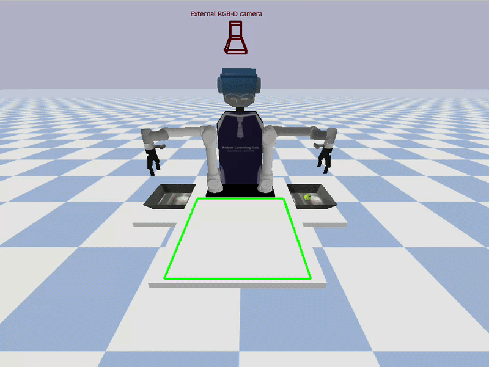
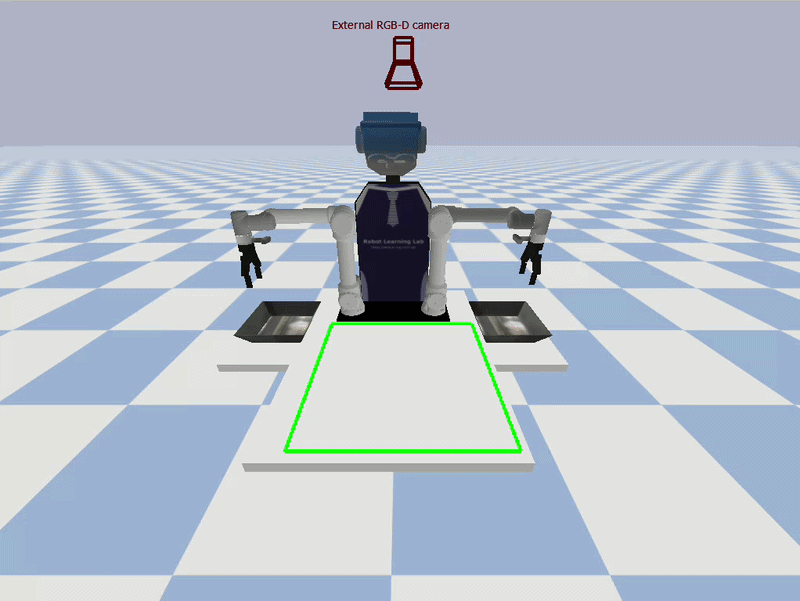
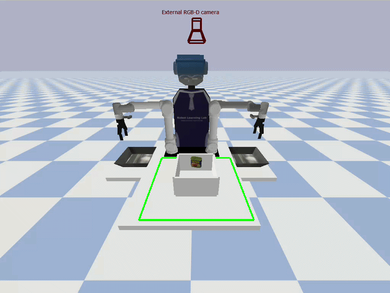
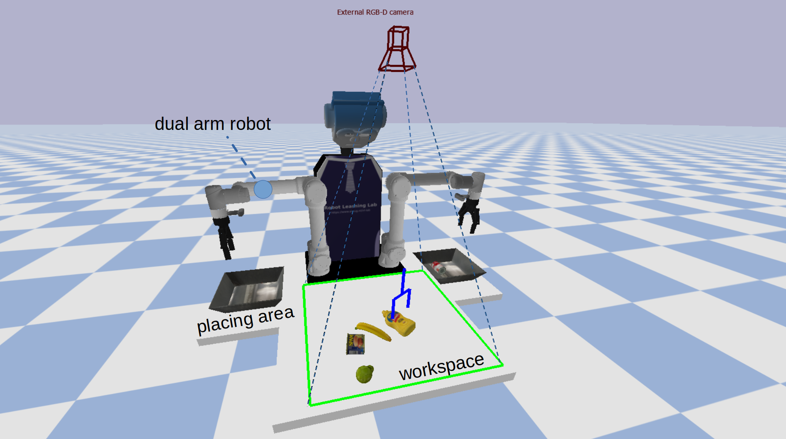
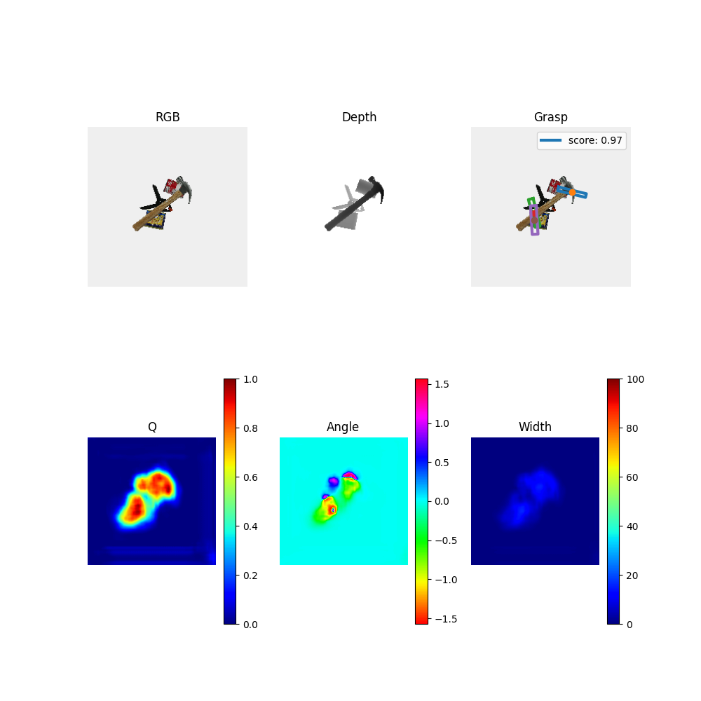
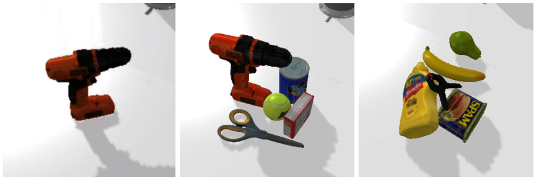
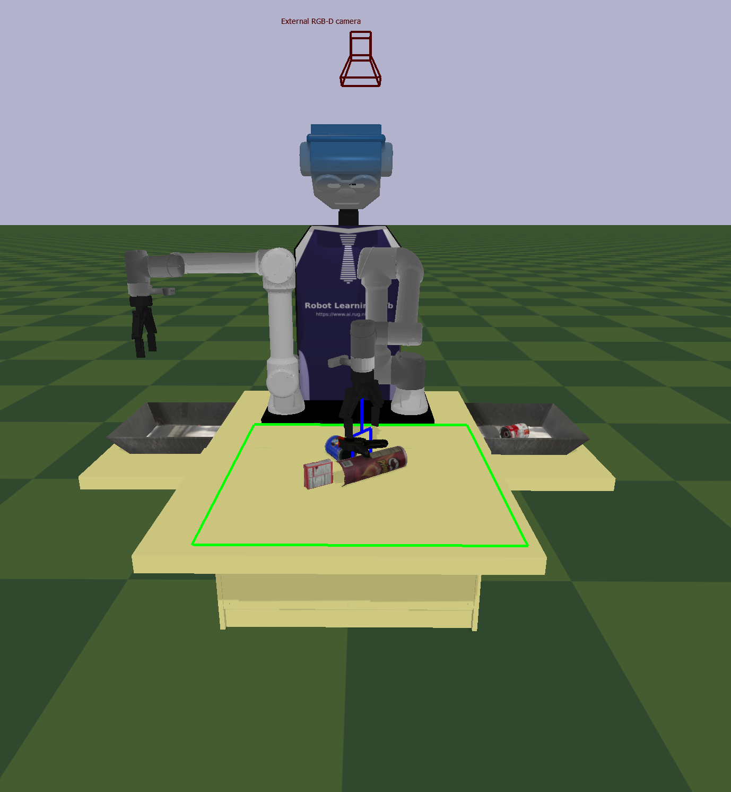
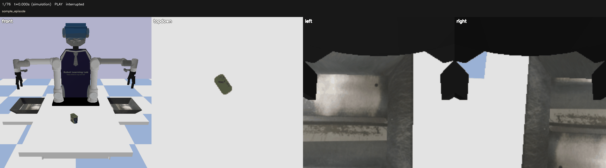
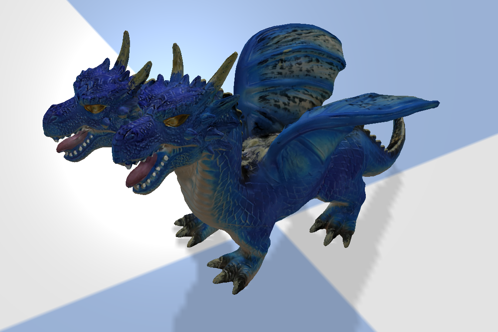

## Coupling between Perception and Dual-Arm Manipulation: Learning to Grasp Objects in Highly Cluttered Environments

###### [Hamidreza Kasaei](https://hkasaei.github.io/) | [IRL-Lab](https://www.ai.rug.nl/irl-lab)
##
***NOTE:*** You are not allowed to share this repository and use it in other projects without getting permission from Hamidreza Kasaei (contact: hamidreza.kasaei@rug.nl)

<p align="center">
  
  
  
</p>
<p align="center">
   Three scenarios: (left) isolated scenario, (center) packed scenario, and (right) pile scenario.
</p>

# Overview
Service robots typically use a perception system to perceive the world. The perception system provides valuable information that the robot has to consider for interacting with users and environments. A robot needs to know how to grasp and manipulate objects in different situations to assist humans in various daily tasks. For instance, consider a robotic task such as clearing the table. Such tasks consist of two phases: the first one is the perception of the object, and the second phase is dedicated to the planning and execution of the manipulation task. In this assignment, you mainly focus on the topic of deep visual object grasping and manipulation.

The main goal of this assignment is to make a coupling between perception and manipulation using eye-to-hand or eye-in-hand camera coordination. To this end, we have developed a simulation environment in [PyBullet](https://pybullet.org/wordpress/), in which a dual-arm robot (UR5e) with Robotiq 2F-140 grippers perceives the environment using RGB-D cameras. The experimental setup for this assignment is shown in the following figure. This setup is very useful to extensively evaluate different object grasping approaches.

<p align="center">
  
</p>
<p align="left">
  Our experimental setup consists of a table, two baskets, a dual-arm robot, and objects from YCB dataset. The green rectangle shows the robot's workspace, and the camera indicates the pose of the external camera in the environment. 
</p>


***We are pursuing three main goals:*** (i) learning about at least two deep visual grasping approaches, (ii) evaluating and comparing their performances in three scenarios: isolated, packed, and pile (see a video of each scenario above); (iii) investigating the usefulness of formulating object grasping as an object-agnostic problem for general-purpose tasks. ***You can also use this setup to develop your final course project***.

In this assignment, we capture an RGB-D image of the scene and pass the image to a deep convolutional neural network to obtain pixel-wise grasp configuration in terms of grasp quality, grasp angle, and grasp width. To make it clear, we visualize the output of the GR-ConvNet network for a given image:

<p align="center">
  
</p>
<p align="center">
  Outputs of the GR-ConvNet network for a given image
</p>

The best grasp configuration is then selected, and we convert the grasp pose from pixel space to the robot's workspace (x, y, z, roll, pitch, yaw). We finally instruct the robot to perform a clear table task by grasping and manipulating the target object from the table to the basket. A particular grasp is ed as a success if the object is inside the basket at the end of the experiment.  An experiment is continued until either all objects get removed from the workspace or four failures occur consecutively (the default is `--attempts=4`). Note that the system automatically reports a summary of the obtained results in the “results” folder, and the prediction of the network is visualized and saved in the “network_output” folder.


## Requirements

### Nix development environment (recommended)

The flake provides Python 3.11, uv, a C/C++ compiler, CMake, Ninja, pkg-config,
graphics/USB runtime libraries on Linux, FFmpeg, and dataset download utilities.
Python dependencies are managed by uv in `.venv` and pinned in `uv.lock`;
Nix tools and libraries are pinned in `flake.lock`.

With Nix and the `nix-command` and `flakes` features enabled, run from this
repository's root:

```bash
nix develop
uv sync --locked
uv run python simulation.py --scenario=pile --network=GR_ConvNet --runs=1 --device=CPU
```

The shell uses Nix's Python and disables uv's standalone Python downloads so
binary wheels use the Nix loader on NixOS. Enter `nix develop` again whenever
working on the project. The first sync needs network access to download wheels
(and a PyBullet source build on platforms without a wheel).

### Without Nix

Install [uv](https://docs.astral.sh/uv/getting-started/installation/), then run:

```bash
uv sync --locked
uv run python simulation.py --scenario=pile --network=GR_ConvNet --runs=1 --device=CPU
```

uv installs Python 3.11 if needed and manages the virtual environment. A source
build of PyBullet requires a C/C++ compiler and Python development headers.
On macOS, install the Xcode command-line tools before syncing. macOS and Linux
ARM environments have not been validated here.

### Optional hardware and dependency notes

The simulator does not need a RealSense camera. To use the physical camera
utilities under `network/hardware`, install the platform-specific bindings:

```bash
uv sync --locked --extra realsense
uv run --extra realsense python -c "import pyrealsense2"
```

RealSense wheel availability depends on the OS and architecture; the macOS
bindings currently require Apple Silicon and macOS 15 or later. Physical camera
access also needs the host's USB permissions/udev rules.

- NumPy stays below 2 for compatibility with the existing simulation. OpenCV
  stays below 4.12 because newer wheels require NumPy 2 on Python 3.11.
- OpenCV uses the headless wheel. For simulation previews, use
  `--stream_backend=matplotlib`. Interactive episode playback requires a GUI
  OpenCV build; verification and video/GIF export work with the headless wheel.
  To switch this environment to GUI OpenCV, run `uv remove opencv-python-headless`
  and `uv add "opencv-python>=4.8,<4.12"`; do not install both wheel variants.
- PyTorch uses its standard PyPI distribution, including CUDA dependencies on
  supported Linux systems. GPU inference needs a compatible host NVIDIA driver;
  the simulation falls back to CPU when CUDA is unavailable.
- PyBullet source builds receive the same NumPy version as the runtime. Check
  support with `uv run python -c "import pybullet; print(pybullet.isNumpyEnabled())"`.

Run the headless test suite with:

```bash
MPLBACKEND=Agg uv run --locked python -m unittest discover -s tests
```

Use `uv add <package>` / `uv remove <package>` to change dependencies and
`uv lock --upgrade` to refresh Python pins. Use `nix flake update` to refresh
Nix pins. Commit the updated manifest and lockfiles together.

## How to run experiments
We can perform a simulation experiment by running the 'simulation.py' script. As shown in the following image, we can perform experiments in three different grasping scenarios, including isolated, packed, and pile scenarios:

<p align="center">
  
</p>


```bash
cd ~/dual_arm_manipulation_pybullet
uv run python simulation.py --scenario=pile --network=GR_ConvNet --runs=5
```

### Simulation parameters

All command-line options for `simulation.py` are listed below. Omitted options
use their defaults.

| Parameter | Default | Description and accepted values |
|---|---|---|
| `--scenario` | `isolated` | Scene type: `isolated`, `packed`, or `pile`. |
| `--network` | `GR_ConvNet` | Network selector: `GR_ConvNet` or `GGCNN`. The selected backend must be implemented; see the note below. |
| `--runs` | `1` | Number of scene rounds. Each isolated run sweeps through every object in the configured object list. |
| `--attempts` | `4` | Consecutive placement-failure limit per round; a successful placement resets the count. Also sets the number of grasp candidates requested. |
| `--save-network-output` | `true` | Save network prediction plots in `network_output/`. |
| `--device` | `GPU` | Inference device: `CPU` or `GPU` (case-insensitive). GPU requests fall back to CPU if CUDA is unavailable. |
| `--gui` | `true` | Show the PyBullet GUI; `false` uses DIRECT/headless simulation. |
| `--domain_randomization` | `false` | Randomize table/floor colors, object textures, lighting, and RGB brightness per episode. |
| `--domain_seed` | `3` | Integer seed for appearance sampling when domain randomization is enabled; does not seed object placement or physics. |
| `--stream_cameras` | `false` | Show live camera previews. Requires `--gui=true`. |
| `--stream_backend` | `opencv` | Preview backend: `opencv` or `matplotlib`. |
| `--stream_async` | `true` | Display OpenCV previews in a separate process. Camera capture remains on the simulation thread; applies to the OpenCV backend. |
| `--stream_fps` | `5` | Maximum live-preview frames per wall-clock second; must be a finite positive number. |
| `--stream_which` | Not set (scenario cameras) | Comma-separated preview cameras: `external`, `front`, `head`, `left`, `right`. Isolated defaults to `front,left,right`; packed/pile defaults to all five. |
| `--_episodes` | `false` | Save camera episodes for offline playback. Works with or without the PyBullet GUI. |
| `--record_dir` | `episodes` | Root directory for episode folders. |
| `--record_fps` | `3` | Recording frames per simulated second; must be finite and greater than `0`, up to `240`. |
| `--record_which` | `front,external,left,right` | Comma-separated recording cameras: `external`, `front`, `head`, `left`, `right`. |
| `-h`, `--help` | — | Print usage and available options, then exit. Takes no value. |

Boolean options take an explicit value, for example `--gui=false` or
`--record_episodes=true`. Both camera-list options use identifiers without spaces,
for example `--stream_which=front,external`; `external` is displayed as **topdown**.

Override any default by passing its option explicitly. GPU inference falls back
to CPU when CUDA is unavailable. Recording settings apply when
`--record_episodes=true`; the appearance seed applies when domain randomization
is enabled.

Select `--network=GR_ConvNet` for the active 224 × 224 RGB-D baseline.
The parser also accepts `--network=GGCNN` for a 300 × 300 depth-only backend,
but its initialization and inference branches are currently commented out.
Implement or enable those branches before running GGCNN, for example:

```bash
uv run python simulation.py --scenario=pile --network=GGCNN --runs=1 \
  --gui=true --device=GPU --save-network-output=true \
  --record_episodes=true --record_dir=episodes --record_fps=3 --record_which=front,external,left,right 
 
```

GGCNN receives metric depth with its mean removed, clipped to `[-1, 1]`. Its
checkpoint encodes widths relative to **150 pixels**; this decoding scale is
independent of `MAX_GRASP` and differs from GR-ConvNet. Prediction plots are saved
under `network_output/` by default; use `--save-network-output=false` to disable them.

The PyBullet grasp marker previews a gripper opening capped at `MAX_GRASP`
(8.5 cm), plus 2 cm total visual padding. Wider network predictions are drawn at
this limit; the raw predicted widths and saved network plots retain their values.

Camera streaming is off by default. Enable it with `--stream_cameras=true`;
the default backend displays an OpenCV mosaic. Your OpenCV build must include GUI
support; if you installed `opencv-python-headless` with `uv sync`, use
`--stream_backend=matplotlib` or replace the headless package with a GUI-enabled
OpenCV build. Do not install both OpenCV wheel variants in the same environment.

```bash
uv run python simulation.py --scenario=pile --network=GR_ConvNet --runs=2 --save-network-output=true --stream_cameras=true --stream_backend=opencv --device=GPU --gui=true
```

OpenCV displays the preview in a separate process by default (`--stream_async=true`).
The worker builds the mosaic and handles window events; a queue holds at most one
pending frame and drops old frames when display falls behind. Qt window calls stay
on the display process's main thread. Use `--stream_async=false` for display in the
simulation process. This option applies to the OpenCV backend.

The `front` camera renders and records at **640 × 640 pixels** by default. The
topdown, head, and wrist cameras match the selected network input: **224 × 224**
for GR-ConvNet or **300 × 300** for GGCNN.
Live OpenCV mosaics fit the images into tiles matching the smallest selected camera;
this affects display only. With GR-ConvNet, the mosaic uses 224-pixel tiles:
four tiles (**448 × 448**) or six (**672 × 448**) when all five cameras are selected,
including blanks for unused slots. Recorded PNGs keep each camera's native resolution.

The fixed `front` camera observes the robot from in front of the worktable, framing
the head, both arms, both baskets, and the workspace. It is separate from `external`,
the overhead camera used for grasp prediction. Its position, target, and field of
view are set by `FRONT_CAMERA_POS`, `FRONT_CAMERA_TARGET`, and `FRONT_CAMERA_FOV` in
`environment/env.py`; `FRONT_CAMERA_SIZE` sets its independent capture resolution. Select it alone
with `--stream_which=front`, or include it in any camera list. New recordings include
it by default; existing recordings still play as before.

Each preview frame still captures the selected cameras on the simulation thread;
moving display to a worker does not remove PyBullet rendering time. For a
lighter preview, add `--stream_fps=2 --stream_which=external`. To see both wrist
cameras, use `--stream_which=left,right`. The default limit is 5 FPS; the selected
cameras otherwise follow the scenario defaults. Press `q` or Escape in the OpenCV
window to stop streaming while the simulation continues.

### Domain randomization

<p align="center">
  
</p>


Enable per-episode changes to table/floor colors, object textures, lighting, and
RGB brightness:

```bash
uv run python simulation.py --scenario=pile --network=GR_ConvNet --runs=2 \
  --domain_randomization=true --domain_seed=42 \
  --record_episodes=true --record_fps=3 --stream_cameras=false --gui=true
```

Domain randomization is disabled by default. Settings are sampled once per pile
or packed run, or once per isolated-object episode, and stay fixed throughout
that episode.

The main worktable, both basket platforms, and the stand under the robot share
one sampled table color across all their visual links.

| Setting | Range |
|---|---|
| Table RGB channels | `0.30–0.95` |
| Floor RGB channels | `0.20–0.55` |
| Object textures | Original 30% of the time; otherwise HSV variants with hue ±12°, saturation `0.75–1.25×`, value `0.8–1.2×` |
| Lighting | Yaw ±45°, elevation `40–70°`, with shadows |
| RGB brightness | `0.6–1.4×` |

Textures are generated lazily from each object's original image and cached (up
to eight variants per source) in a temporary directory. Original asset files are
preserved, and cached isolated objects receive a fresh texture choice each
episode. Objects without a discoverable texture retain their appearance.

All five camera views share the episode's lighting and brightness settings, so
inference, live previews, saved predictions, and recordings use the same image
processing. Colors, textures, and lighting also affect the PyBullet GUI; the RGB
brightness multiplier is applied to captured images rather than the GUI viewport.
Depth, segmentation, camera poses/FOV, object geometry, and physics retain their
existing settings. GGCNN consumes depth, so this mode does not alter its input.

`--domain_seed` defaults to `3` and controls appearance sampling only; object-placement randomness
is independent. Recordings save the episode seed, sampled settings, and object
texture choices under `scenario_metadata.domain_randomization` in `episode.json`.


### Record episodes and review them later
<p align="center">
  
</p>

Run these commands from the repository root. Record camera images without opening
live camera windows:

```bash
uv run python simulation.py --scenario=pile --network=GR_ConvNet --runs=2 \
  --save-network-output=false --record_episodes=true --record_dir=episodes \
  --record_fps=3 --record_which=front,external,left,right \
  --stream_cameras=false --device=CPU --gui=true
```

Recording and camera streaming are off by default. Enable them independently with
`--record_episodes=true` and `--stream_cameras=true`. The PyBullet GUI
is controlled separately by `--gui`; recording also works in DIRECT/headless mode.

By default, recordings include the front, topdown, left wrist, and right wrist views.
Select views using the camera identifiers below. The overhead view is displayed as
**`topdown`** in both live previews and the episode viewer; its identifier remains
`external` in command options, saved folders, and metadata, including existing episodes.

| Camera identifier | Display label | View |
|---|---|---|
| `external` | `topdown` | Overhead camera used for grasp prediction |
| `front` | `front` | Fixed frontal view of the robot and table |
| `left` | `left` | Left wrist camera |
| `right` | `right` | Right wrist camera |
| `head` | `head` | Robot head camera; optional |

For example, `--record_which=external,front` records just the topdown and front views.

Each pile/packed run creates one episode after object spawning. The isolated
scenario creates an episode for each object in each run. Frames retain their
original camera resolution: **640 × 640 RGB for front**, **224 × 224 RGB for the
other cameras**. This applies to new recordings; older episodes retain their saved
resolution. Each episode contains:

```text
episodes/episode_<timestamp>_<id>/
  episode.json          # cameras, sizes, FPS, scenario/run, recording status
  frames.jsonl          # frame timestamps and image paths
  external/000000.png   # topdown view; lossless PNG frames numbered per camera
  front/000000.png      # 640 × 640 fixed view of robot behavior and the table
  left/000000.png
  right/000000.png
```

`--record_fps` defaults to **3 frames per simulated second**, using the 240 Hz physics step.
Playback omits wall-clock delays such as network inference. Camera capture still
takes time during recording; reduce the FPS or select fewer cameras for less
overhead. PNG encoding and file writes run in a background thread with a bounded
eight-frame queue. If the disk falls behind, frames are dropped and counted in
`episode.json`; the viewer preserves gaps using the recorded timestamps. Episode
status describes whether recording completed, not whether grasping succeeded.
Ctrl+C finalizes an interrupted episode. Complete indexed frames can also be read
if a process stops before finalizing its metadata.


View **only one specific episode** by passing its complete folder path:

```bash
uv run python view_episodes.py episodes/episode_20261017T151129389913Z_1f48b3 --speed=2 --size=640
```

Replace the example folder name with the episode you want to open. The recorder
prints that path when it starts and saves an episode. Passing `episode.json` inside
the episode folder also works.

To browse **all episodes** under the output directory instead, pass the parent folder:

```bash
uv run python view_episodes.py episodes --speed=2 --size=640

#or specific episode save it as a gif/mp4
uv run python view_episodes.py episodes/sample_episode   --speed=2 --size=640 --save-video=episode.gif

```

`--speed` needs a number: `1` plays at normal simulation speed, `0.5` at half speed,
and `2` at double speed. For example, `--speed=0.5` slows playback down; do not leave
the value empty after `--speed=`.

The episode viewer accepts these parameters:

| Parameter | Default | Purpose |
|---|---|---|
| `path` | Required | Episode folder, its `episode.json`, or a parent directory containing episodes. |
| `--speed` | `1` | Positive playback/export speed relative to recorded simulation time. |
| `--size` | `320` | Positive size in pixels per camera panel for playback or export. |
| `--verify` | Off | Check metadata and every saved image without opening a window. |
| `--save-video` | Off | Export exactly one episode to an `.mp4` or `.gif` file, then exit without opening a window. Relative output paths start in the selected episode folder. |
| `-h`, `--help` | — | Show usage and available parameters. |

The viewer reads saved PNGs and metadata without loading PyBullet or the network.
It displays the selected cameras side by side; `--size` controls camera panels in
playback and exported files, while the recorded PNGs retain their original resolution.
Interactive playback needs a GUI-enabled OpenCV build. No additional Python packages are needed
for the recording format. Controls:

| Key | Action |
|---|---|
| Space | Pause/resume; restart at the end |
| A/D or left/right arrow | Step backward/forward and pause |
| R | Restart the current episode |
| `[` / `]` | Previous/next episode |
| Q, Escape, or Ctrl+C | Quit; Ctrl+C also works from the terminal |

Paused playback and the final frame remain responsive to Ctrl+C and window-close
events. The viewer closes its windows when interrupted.

Verify saved images and metadata without opening a window:

```bash
uv run python view_episodes.py episodes --verify
```

To export one episode as an MP4 video or animated GIF:

```bash
uv run python view_episodes.py episodes/episode_20261017T151129389913Z_1f48b3 \
  --speed=1 --size=320 --save-video=episode.mp4
uv run python view_episodes.py episodes/episode_20261017T151129389913Z_1f48b3 \
  --speed=1 --size=320 --save-video=episode.gif
```

The examples save `episode.mp4` or `episode.gif` inside the selected episode folder.
Relative output paths are resolved from that folder; use an absolute path to save
elsewhere. The output suffix selects the format. Export runs headlessly and exits when the
file is written, using OpenCV for MP4 and Pillow for GIF; no additional packages
or system FFmpeg installation are required. Select exactly one episode when
exporting. `--verify` and `--save-video` cannot be combined.

Export uses `--speed` and the per-camera `--size`. Timestamp gaps hold the previous
frame, and the final frame is held for one nominal recording interval. MP4
resamples this timing to 30 FPS and pads odd output dimensions to even dimensions
when needed. GIF keeps each recorded frame's duration, rounded to 10 milliseconds.


  - Run 'simulation.py --help' to see a full list of options.
    
      - --runs=10 forces the system to run 10 experiments
      - In the ***environment/env.py*** file, we have provided a parameter, namely ***SIMULATION_STEP_DELAY***, to control the speed of the simulator. This parameter should be tuned based on your hardware. 
       
      - After performing each experiment, a summary of the results will be visualized and saved in the ***results*** folder.

      - Network predictions are saved in ***network_output*** by default. Use ***--save-network-output=false*** to disable saving.

## Integrating a new model 

You need to add your trained model to the "trained_models" folder. You can check the code (simulation.py and grasp_generator.py) to see how we integrate and use the GR-ConvNet model. 


## Use Google Scanned Objects dataset

You can download various object models from the following link and insert them into our framework as follows:

Google Scanned Objects dataset: https://app.gazebosim.org/GoogleResearch/fuel/collections/Scanned%20Objects%20by%20Google%20Research

```
texture_id = p.loadTexture('/home/hamidreza/Downloads/Animal_Planet_Foam_2Headed_Dragon/materials/textures/texture.png')
obj_id = p.loadSDF("/home/hamidreza/Downloads/Animal_Planet_Foam_2Headed_Dragon/model.sdf", globalScaling=1)
p.changeVisualShape(
            obj_id[0], 
            -1,  # Link index (-1 for base link)
            textureUniqueId=texture_id
        )
p.resetBasePositionAndOrientation(obj_id[0],[2,1,0.5],[0,0,0,1])
```

Here is a screenshot of the result:

<p align="center">
  
</p>


### Check all robot behaviors

`test_behaviours.py` checks every registered common behavior and every left, right,
and dual-arm variant by default:

```bash
uv run python test_behaviours.py
```

For a faster run without GUI rendering or pauses between checks:

```bash
uv run python test_behaviours.py --vis=false --sleep=0
```

Each check reports `PASS`, `FAIL`, or `SKIP`, followed by a summary. Failures return
exit code 1, and remaining checks continue after a failure. Checks verify actual
joint positions, IK position/orientation errors, gripper movement, object poses,
camera buffers and saved images, and EE marker movement. Throwing and speech are
reported as skipped because they are stubs. Headless runs also skip trajectory
line rendering after checking the trajectory points; marker bodies are checked
in both modes. Closing an empty gripper is checked by finger movement, since its
return value indicates object contact rather than movement success.

Use `--robot=left`, `--robot=right`, or `--robot=dual` to check one variant plus the
common behaviors. Camera files are verified in a temporary directory and removed
afterward; add `--output-dir=results/behavior_checks` to keep them. Interactive
commands remain available with `--interactive=true` (the default robot is `dual`
in interactive mode).

`visualize_target_ee_pose` places a static marker at the desired **tool0 pose in
world coordinates**. Its mesh origin is at the gripper mount, with no fingertip/TCP
offset. Pass the same quaternion used for IK so the marker shows the intended
orientation; omitting it uses identity (the fingers point along world +Z). Dual
calls accept a shared `orientation_xyzw` and per-arm overrides. The behavior
checker supplies each arm's top-down IK orientation. To follow the robot's actual
tool0 pose continuously, use `enable_eef_mesh_debug`.

### Object contact settings

Objects use a lateral friction coefficient of `0.6`, rolling/spinning friction of
`0.005`, and disabled friction anchoring. The gripper pads keep their higher lateral
friction (`2.5`) so the fingers can hold objects while neighbouring objects can slide
and separate. These settings apply when objects are loaded or reused; restart the
simulation to apply changed defaults to a new run.

The previous object coefficient of `2.5` produced an object-object coefficient of
`6.25`, because [Bullet multiplies the two surface coefficients](https://github.com/bulletphysics/bullet3/blob/master/src/BulletCollision/CollisionDispatch/btManifoldResult.cpp).
Together with anchored friction, those settings reproduced a lifted object carrying
a neighbouring object suspended beneath it in the pile-and-lift regression test.

Optional environment overrides:

| Variable | Default |
|---|---|
| `PB_OBJECT_LATERAL_FRICTION` | `0.6` |
| `PB_OBJECT_ROLLING_FRICTION` | `0.005` |
| `PB_OBJECT_SPINNING_FRICTION` | `0.005` |

## References

- Simulation
  - The simulation code is an adaptation from the following repositories: 
      - https://github.com/ElectronicElephant/pybullet_ur5_robotiq  
      - https://github.com/JeroenOudeVrielink/ur5-robotic-grasping
  - Object models were taken from the following repository: https://github.com/eleramp/pybullet-object-models
  


- Networks that you can use
  - GR-CONV [default]: https://github.com/skumra/robotic-grasping 
  - GGCNN:  https://github.com/dougsm/ggcnn
  - C_GR_ConvNet: https://github.com/krishkribo/3D_GDM-RSON
  - GDP [implemented as a baseline in VGN repo]: https://github.com/ethz-asl/vgn
  - HGGD: https://github.com/THU-VCLab/HGGD
  - S4G: https://github.com/yzqin/s4g-release
  - VGN: https://github.com/ethz-asl/vgn 
   

- Papers:
   - Hamidreza Kasaei and Mohammadreza Kasaei. MV-grasp: Real-time multi-view 3D object grasping in highly cluttered environments. arXiv preprint arXiv:2103.10997, 2021
  
  - Oude Vrielink, Jeroen, Hamidreza Kasaei. Learning to grasp objects in highly cluttered environments using Deep Convolutional Neural Networks. BSc Diss. 2021.
  
  - Sulabh Kumra, Shirin Joshi, and Ferat Sahin.  Antipodal robotic grasping using a generative residual convolutional neural network. In 2020 IEEE/RSJ International Conference on Intelligent Robots and Systems(IROS), pages 9626–9633, 2020. doi: 10.1109/IROS45743.2020.9340777.

## CONTACT INFORMATION 

1. Please use the following email addresses if you have questions or want to contribute to this project:
	- :email: <hamidreza.kasaei@rug.nl> 
2. check out IRL-Lab [website](www.ai.rug.nl/irl-lab) for more information about other projects.

## TODO

- Add a param to save/not save the results
- Objects disappear after several runs, check the potential reasons. You can press W to see the simulation in CAD mode


## License and Usage Restrictions

**Copyright © 2026 Hamidreza Kasaei. All rights reserved.**

This repository is provided exclusively for educational purposes within the **Cognitive Robotics** course.
Authorized students may clone, run, and modify the code for course assignments.

**Without prior written permission, users are not permitted to:**
- Make the code publicly available.
- Share, redistribute, or publish the code.
- Incorporate the code into other projects.

For permission requests, contact **Hamidreza Kasaei** at [hamidreza.kasaei@rug.nl](mailto:hamidreza.kasaei@rug.nl).

By accessing or using this repository, users agree to these terms.

